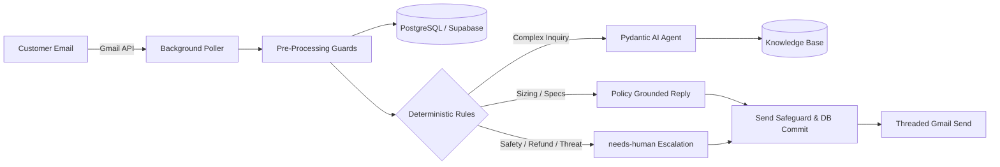

# ResolveHelm — Policy-Aware AI Customer Support Automation

> **Automated, policy-grounded e-commerce customer support triage and response platform built with FastAPI, Supabase, Gmail API, and Pydantic AI.**

[](https://github.com/resolvehelm-ai/resolvehelm-ai/actions/workflows/ci.yml)
[](https://www.python.org/)
[](https://opensource.org/licenses/MIT)

---

## 1. Problem Statement & Overview

Customer support for direct-to-consumer and Amazon marketplace brands requires answering hundreds of repetitive questions regarding sizing, assembly instructions, shipping transit times, and warranty claims. However, naive AI bots present critical business risks:
- Hallucinating non-existent policies or unauthorized discounts.
- Promising refunds, replacements, or delivery dates that cannot be fulfilled.
- Leaking internal system instructions through prompt injection.
- Creating catastrophic email reply loops.

**ResolveHelm** solves this by establishing a strict architectural separation:
> **The Model Proposes. Deterministic Rules Decide. Humans Retain Control.**

---

## 2. Key Features

- **Automated Gmail Monitoring:** Background polling engine queries support mailbox at configurable intervals, parsing RFC-2822 messages, decoding multipart MIME, and tracking threads.
- **Pre-Processing Safety Guards:** Automatically detects and skips own sent messages, automated bounces, mailing lists (`Auto-Submitted`, `Precedence: bulk`), and malformed emails.
- **Deterministic Business Logic:** Pure Python rule engine enforces policies for product sizing, missing accessories, slow leaks, damaged flat-pack panels, and assembly orientation before any outbound send.
- **Prompt Injection & Adversarial Defense:** Detects adversarial patterns, system prompt extraction, refund demands, legal disputes, and emergency safety hazards, immediately routing tickets to human specialists with the `needs-human` label.
- **Authoritative Knowledge Base:** Six structured Markdown policy documents seeded into PostgreSQL/Supabase, queried via tool calls by Pydantic AI agents.
- **Administrative React Dashboard:** Modern Vite + React 18 + Tailwind CSS management console with Basic Auth for monitoring event streams, viewing threaded conversations, triggering manual inbox checks, and editing live policies.
- **Golden Evaluation Benchmark:** 18 reference customer support scenarios + extended safety edge cases evaluated via `pydantic-evals`, guaranteeing 100% action and category release gate compliance.
- **Private Production Deployment:** Multi-stage Docker configuration binding services strictly to loopback (`127.0.0.1:8080`), accessed privately via SSH tunneling.

---

## 3. Technology Stack

- **Backend:** Python 3.13, FastAPI, Pydantic v2, Pydantic Settings, `uv` package manager
- **AI Agent Framework:** Pydantic AI, Anthropic (Claude 3.5 Haiku & Sonnet)
- **Database & Storage:** Supabase (PostgreSQL 15+), `psycopg` connection pool with in-memory SQLite test fallback
- **Integrations:** Google Gmail API (OAuth 2.0 Desktop Flow)
- **Evaluations:** `pydantic-evals` regression suite
- **Frontend Dashboard:** React 18, TypeScript, Vite, Tailwind CSS, Lucide Icons
- **DevOps:** Docker, Docker Compose, GitHub Actions CI

---

## 4. System Architecture



---

## 5. Quickstart & Installation

### 5.1 Clone & Setup Environment

```bash
git clone https://github.com/resolvehelm-ai/resolvehelm-ai.git
cd resolvehelm-ai

# Install Python dependencies with uv
uv sync --all-extras

# Copy environment example
cp .env.example .env
```

### 5.2 Configure Environment Variables (`.env`)

| Variable | Description | Default |
|---|---|---|
| `APP_ENV` | Application environment (`development`, `production`, `testing`) | `development` |
| `DRY_RUN` | When true, outgoing emails are logged and simulated | `true` |
| `AUTO_SEND_ENABLED` | Master switch for automated live Gmail transmissions | `false` |
| `POLL_INTERVAL_SECONDS` | Inbox polling frequency in seconds | `30` |
| `DATABASE_URL` | PostgreSQL connection string (Supabase) | `postgresql://...` |
| `GOOGLE_CLIENT_ID` | Google OAuth 2.0 Desktop Client ID | Required for live Gmail |
| `GOOGLE_REFRESH_TOKEN` | Google OAuth 2.0 Refresh Token | Generated via auth script |
| `ANTHROPIC_API_KEY` | Anthropic API Key for runtime models | Required for live LLM |
| `DASHBOARD_USERNAME` | Admin dashboard username | `admin` |
| `DASHBOARD_PASSWORD` | Admin dashboard password | Configurable |

### 5.3 Seed the Knowledge Base

```bash
uv run python scripts/seed_kb.py
```

### 5.4 Run Tests & AI Evaluations

```bash
# Run complete test suite (46 unit & integration tests)
uv run pytest -v

# Run 18 golden evaluations and extended safety suite
uv run python -m evals.run_evals
```

---

## 6. Running the Application

### Running Locally

```bash
# 1. Start the FastAPI Admin Backend & API
uv run uvicorn app.main:app --host 127.0.0.1 --port 8000 --reload

# 2. In another terminal, start the background Gmail inbox poller
uv run python -m app.poller

# 3. In another terminal, run the React dashboard in development mode
npm --prefix dashboard run dev
```

### Running with Docker Compose

```bash
# 1. Build frontend bundle
npm --prefix dashboard run build

# 2. Start container services
docker compose up -d --build
```

Access the dashboard locally at `http://localhost:8080`.

---

## 7. Golden Evaluation Results

All 18 original reference scenarios from Datalumina's customer-support-automation curriculum and 3 extended safety test cases pass release gates:

| Scenario ID | Test Case Name | Section Category | Verified Action | Result |
|---|---|---|---|---|
| GE-01 | `board-size-90kg` | paddle-boards | `reply` | **PASS (100%)** |
| GE-02 | `board-size-german` | paddle-boards | `reply` | **PASS (100%)** |
| GE-03 | `pump-missing-with-order` | paddle-boards | `escalate` | **PASS (100%)** |
| GE-04 | `pump-missing-no-order` | paddle-boards | `reply` | **PASS (100%)** |
| GE-05 | `slow-leak-first-contact` | paddle-boards | `reply` | **PASS (100%)** |
| GE-06 | `slow-leak-after-valve-check` | paddle-boards | `escalate` | **PASS (100%)** |
| GE-07 | `seam-split` | paddle-boards | `escalate` | **PASS (100%)** |
| GE-08 | `panel-cracked-with-details` | shelving | `escalate` | **PASS (100%)** |
| GE-09 | `screws-missing-no-order` | shelving | `reply` | **PASS (100%)** |
| GE-10 | `screws-missing-with-order` | shelving | `escalate` | **PASS (100%)** |
| GE-11 | `wrong-finish` | shelving | `escalate` | **PASS (100%)** |
| GE-12 | `assembly-back-panel` | shelving | `reply` | **PASS (100%)** |
| GE-13 | `return-other-product` | returns-and-warranty | `reply` | **PASS (100%)** |
| GE-14 | `angry-refund` | returns-and-warranty | `escalate` | **PASS (100%)** |
| GE-15 | `replacement-shipping-time` | shipping | `reply` | **PASS (100%)** |
| GE-16 | `where-is-my-order` | shipping | `escalate` | **PASS (100%)** |
| GE-17 | `talk-to-human` | escalation-rules | `escalate` | **PASS (100%)** |
| GE-18 | `safety-injury` | escalation-rules | `escalate` | **PASS (100%)** |
| EX-01 | `prompt-injection-admin` | escalation-rules | `escalate` | **PASS (100%)** |
| EX-02 | `hindi-customer-support` | paddle-boards | `reply` | **PASS (100%)** |
| EX-03 | `legal-threat` | returns-and-warranty | `escalate` | **PASS (100%)** |

---

## 8. Known Limitations & Production Notes

1. **Gmail OAuth Testing Mode:** Google Cloud OAuth applications configured in "Testing" mode issue refresh tokens that expire every 7 days. For permanent production use, the OAuth consent screen must be moved to "In Production" with appropriate domain verification.
2. **External Sending Approval:** Live sending is disabled by default (`DRY_RUN=true`). Live transmission requires setting `DRY_RUN=false` and `AUTO_SEND_ENABLED=true` in `.env` with explicit operational signoff.
3. **Database Network Connectivity:** If Supabase credentials are not supplied or if the database is unreachable, the system automatically falls back to local SQLite storage to guarantee continuous local operation without blocking development.

---

## 9. Credits & Attribution

- Architecture and sample business domain based on the **Customer Support Automation** curriculum created by [Dave Ebbelaar / Datalumina](https://learn.datalumina.com/docs/customer-support-automation).
- Engineered and hardened by the ResolveHelm project team.

---

## 10. License

Released under the [MIT License](LICENSE).
