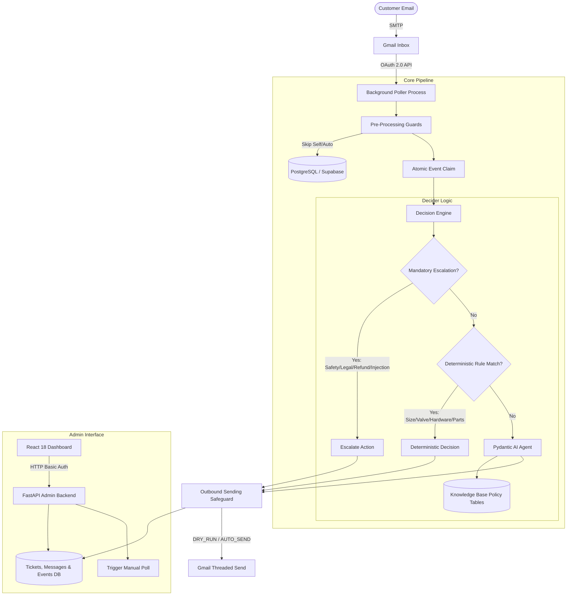

# ResolveHelm Architecture & Security Specification

## 1. System Overview

ResolveHelm is an automated customer support operations platform designed to safely triage, evaluate, and respond to e-commerce customer emails using knowledge-grounded AI models backed by deterministic business logic.

## 2. Core Security Invariants

1. **Principle of Deterministic Rule Supremacy:**
   The AI model only proposes replies; pure Python business rules evaluate and finalize decisions. If a customer request touches financial refunds, legal disputes, safety hazards, attachments, or prompt injection patterns, mandatory escalation immediately overrides any model response.

2. **Outbound Send Idempotency & Protection:**
   The application defaults to `DRY_RUN=true` and `AUTO_SEND_ENABLED=false`. Sending actions are recorded durably with event state tracking to prevent duplicate emails across retries or application restarts.

3. **Loopback Server Binding:**
   The administrative dashboard and API bind strictly to `127.0.0.1:8080` in production containers. Public traffic cannot access the administrative dashboard directly; authorized operators access the dashboard via an SSH tunnel (`ssh -L 8080:localhost:8080`).

4. **Human Thread Ownership Protection:**
   Once a thread is escalated to `needs-human`, subsequent customer follow-ups are protected from automated interference. Human agents retain complete control of escalated conversations.
